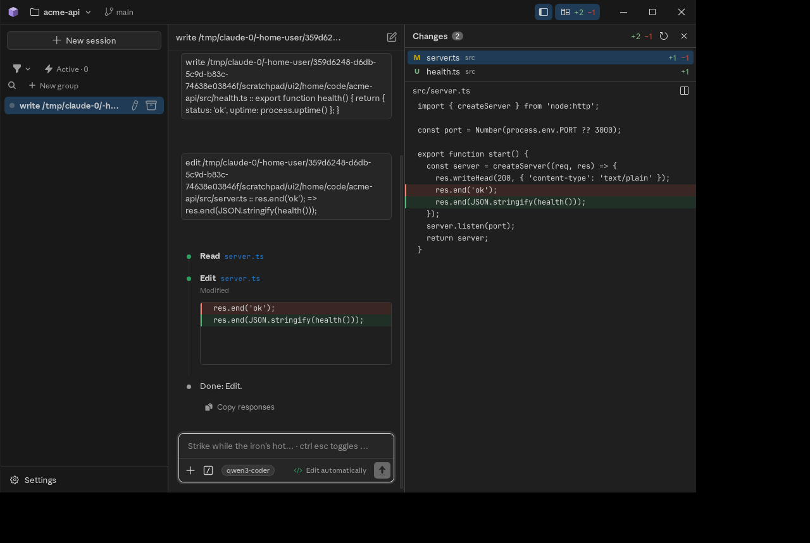

# Forge Desktop

Forge in its own window: the same chat, agent, permission prompts, sessions
and settings as the Forge VS Code extension, with no editor. Built with
[Tauri 2](https://tauri.app) (Rust) for Windows.

The design is `docs/forge-desktop-plan.md` in
[AmineXSaid/FORGE](https://github.com/AmineXSaid/FORGE). This repository is
milestones **M1** (chat with the real agent in a folder you choose) and the
desktop shell of **M2** (title bar, sessions sidebar, project switcher), plus
the **Changes** pane from M6.

## The window



- **Title bar** (the window has no native frame): the project, with a menu of
  recent projects and Open folder…; the git branch; a sidebar toggle; and
  **Changes** with the working tree's `+added −removed` lines, updated while
  the agent works.
- **Sidebar**: New session and the project's sessions, from Forge's session
  manager: groups, live status dots, unread, search and filters, rename and
  archive. Settings opens in the app (Ctrl+,).
- **Chat**: Forge's chat page: the composer, permission prompts, model and
  mode menus, tool output, rewind and fork.
- **Changes pane** (Ctrl+Shift+D): every changed file against HEAD, with its
  line counts, and the selected file's diff, inline or side by side.
- Switching projects restarts the host in the new folder. The sidebar and
  pane widths are remembered.

Shortcuts: Ctrl+B sidebar, Ctrl+Shift+D Changes, Ctrl+, Settings.

## How it works

```text
 Forge's page (WebView2) ──forge_send──▶ Rust (src-tauri) ──stdin──▶ Node sidecar (Forge's host)
                        ◀──Channel──────                 ◀──stdout──        │
                                                                            └── Claude Code CLI
```

- **The page** is Forge's `desktop` page (`src/webview/src/desktop/` in
  FORGE): the shell above, built from Forge's own session list, chat, settings
  and diff renderer. It is Forge's page: `dist/media` from a Forge build, and
  the HTML that Forge's `WebViewService` writes for its chat view (printed at
  build time). An initialization script gives it the `acquireVsCodeApi()` it
  expects. Its `postMessage` calls `forge_send`, and host messages come back as
  `message` events, as in VS Code.
- **The host** is Forge's extension host, unchanged: `host/main.ts` calls
  Forge's real `activate()`, then resolves the chat view with a webview that
  talks over stdio. `vscode` resolves to `host/vscodeShim.ts` (settings and
  state in JSON files, `node:fs`, a file log, native dialogs). Members the
  shim doesn't implement throw `Forge Desktop: vscode.<name> is not available
  yet`, and Forge's dispatcher reports that as a failed request.
- **Rust** also serves the shell's own calls (`src-tauri/src/desktop.rs`):
  project info and switching (to a recent project, or through the folder
  picker), git status and one file's before/after (only files git lists as
  changed), and the window buttons.
- **Rust** checks every page message before it reaches Node: a known type,
  ids of a sane size, a size limit, and no page-supplied `webviewId`. It runs
  a fixed list of host calls (folder, file and save dialogs; http, https and
  mailto links; Show in folder; window title). It also owns the window, the
  folder choice and the recent-folders list.

M1 needs no changes to Forge itself.

## Build and run (Windows)

You need:
- Git;
- Node.js 22 or later, and pnpm 10 (`corepack enable`);
- Rust with the MSVC toolchain (`rustup`, plus the Visual Studio C++ Build Tools);
- WebView2, which Windows 11 already has.

Clone both repositories side by side:

```powershell
git clone https://github.com/AmineXSaid/FORGE
git clone https://github.com/AmineXSaid/forge-desktop
cd FORGE; pnpm install; cd ..
cd forge-desktop; pnpm install
pnpm run prepare:app   # builds Forge's webview and claude.exe, the host, and stages them
pnpm dev               # opens the window (`pnpm build` makes the installer)
```

If Forge is somewhere else, set `FORGE_SRC` to that folder. The window needs
Forge's `desktop` page, which is on FORGE's `claude/dazzling-cori-sdq7bx`
branch until it is merged: `git -C FORGE checkout claude/dazzling-cori-sdq7bx`.

`prepare:app` must run on Windows. pnpm installs `claude.exe` only for the
machine it runs on, and Forge's build copies it into the app.

### First launch

1. The app asks for a project folder. To skip the picker, pass one:
   `forge-desktop.exe C:\work\my-project`. After that, it opens the last
   folder you used.
2. The chat uses what the Claude Code CLI already uses: `claude login`,
   `ANTHROPIC_API_KEY`, or a Forge endpoint profile.
3. To use a profile, put it in `%APPDATA%\com.msaid.forge\settings.json`,
   under the same keys as VS Code's `forge.*` settings:

```json
{
  "forge.endpoints": {
    "local": { "wire": "openai", "baseUrl": "http://127.0.0.1:11434/v1", "model": "qwen3-coder", "auth": { "kind": "none" } }
  },
  "forge.endpointProfile": "local"
}
```

| What | Where |
| --- | --- |
| Settings (`forge.*` keys) | `%APPDATA%\com.msaid.forge\settings.json` |
| UI state (session groups, archive, unread, thinking level) | `%APPDATA%\com.msaid.forge\state.json` |
| Recent folders | `%APPDATA%\com.msaid.forge\recent.json` |
| Logs | `%LOCALAPPDATA%\com.msaid.forge\logs\` (`forge-desktop.log`, `forge-host.log`) |
| Conversations | `%USERPROFILE%\.claude\projects\`, shared with the CLI and VS Code |

## Tests

```bash
pnpm test        # host bundle, node --test test/, cargo test
pnpm typecheck   # host/ against Forge's sources
```

`test/sidecar.e2e.test.mjs` runs the real host, the real Claude Code CLI and
Forge's stub gateway. It sends a message, gets the Write permission prompt,
allows it, checks `hello.txt` on disk, then restarts and resumes the session.
It is skipped until `pnpm run prepare:app` has run.

## Not in M1

These come in later milestones (plan §4.5):
- Settings and the other pages Forge opens in an editor tab. A row that opens
  one logs `vscode.window.createWebviewPanel is not available yet`.
- Quick picks and input boxes, which answer "cancelled".
- Endpoint tokens in Credential Manager. Until then they are kept in memory.
- Light theme; tray; toasts; several windows; an embedded terminal.
- Only the dark VS Code theme variables are defined (`web/desktop-host.css`).
